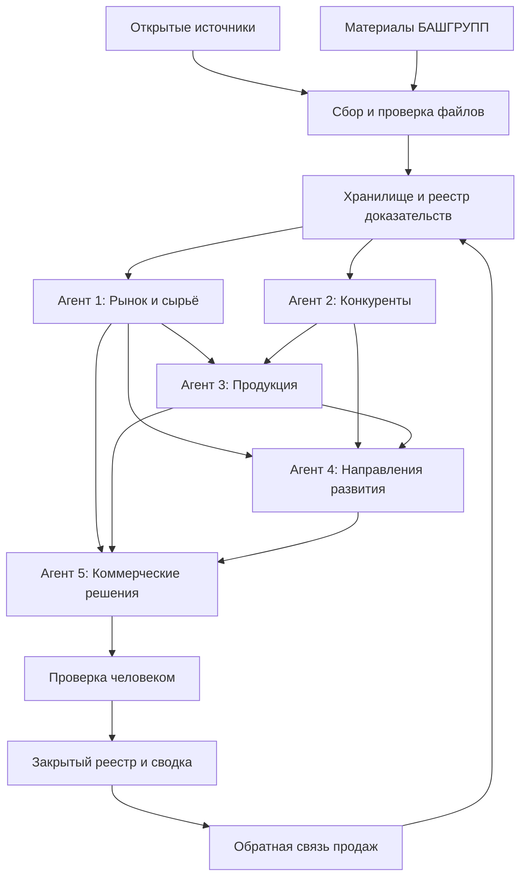

# Техническая карта внедрения ИИ-агентов для ПК БАШГРУПП

| | |
|---|---|
| **Заказчик** | ПК БАШГРУПП |
| **Исполнитель** | ARC AI |
| **Автор** | Konstantin Akaemo'v |
| **Контакты** | [укажите телефон и e-mail] |
| **Версия** | 1.1 |
| **Дата** | 16.10.2026 |
| **Статус** | Для обсуждения |
| **Гриф** | Конфиденциально. Документ предназначен только для ПК БАШГРУПП и ARC AI; передача третьим лицам — по согласованию сторон |

Документ описывает проект внедрения: состав системы, источники данных, архитектуру, этапы, критерии приёмки и требования к данным. Термины, отмеченные при первом упоминании, поясняются в глоссарии (раздел 15). Разделы 6 и 7 предназначены для технических специалистов; для принятия решения достаточно резюме и разделов 1–5 и 8–14.

## Резюме для руководителя

- **Что получит БАШГРУПП.** Систему коммерческой разведки из пяти ИИ-агентов: очередь проверенных строительных объектов на стадии перед отделкой, мониторинг конкурентов и цен на сырьё, сопоставление с продукцией БАШГРУПП и готовые карточки действий для отдела продаж — «кому / что предложить / почему сейчас / следующий шаг». Каждый вывод подкреплён ссылкой на источник.
- **Сроки.** Пилот (этапы 0–4) — 20–31 рабочий день, ориентировочно 4–7 рабочих недель с учётом согласований. Первый пакет проверенных примеров — через 5–8 рабочих дней после старта.
- **Где работает система.** В российском контуре Yandex Cloud, с учётом требований 152-ФЗ о персональных данных.
- **Что нужно от БАШГРУПП.** Ответственный за проект, каталог и кейсы продукции, утверждённый список конкурентов, примеры подходящих и неподходящих объектов, данные по материалам и поставщикам (раздел 12).
- **Стоимость.** См. коммерческое предложение [укажите номер и дату КП] и раздел 11.5.
- **Следующий шаг.** Согласовать объём пилота и назначить ответственного (раздел 14).

## 1. Решение, которое предлагается внедрить

Создать единую систему коммерческой разведки с пятью аналитическими агентами, общей базой доказательств и очередью возможностей для отдела продаж. Главный результат — проверенные объекты и коммерческие действия: куда заходить, через какую организацию, с каким продуктом, почему сейчас и что ещё нужно выяснить.

Рекомендуемый порядок запуска (по ответам анкеты; окончательно согласуется на этапе 0):

**1а Объекты и покупатели → 2 Анализ конкурентов → 1б Сырьё и технологии → 3 Анализ продукции → 4 Направления развития → 5 Коммерческие решения.**

Агенты 1а и 1б — два модуля агента 1 «Исследование рынка» (подробнее в разделе 4).

Пять агентов — это пять специализированных процессов с отдельными правилами, входами и результатами. Они могут работать на одной языковой модели, поэтому совпадение их ответов не считается подтверждением факта: факт подтверждается только источником. Сбор данных, расчёты, права доступа и публикацию выполняет программная часть системы; языковая модель извлекает сведения из документов и формирует обоснованные интерпретации.

## 2. Что установлено из анкеты

Изучены все 12 ответов анкеты «AI-агенты для ПК БАШГРУПП.xlsx».

| Вопрос анкеты | Что сообщил заказчик | Следствие для внедрения |
|---|---|---|
| Вопрос 1 | Покупатели, конкуренты, сырьё; особенно интересны объекты перед отделкой | Основной поток — поиск объектов и проверка стадии. Для сырья — отдельный модуль внутри агента рынка |
| Вопрос 2 | Интерьер приоритетен; экстерьер на перспективу; металлические потолки и декоративные изделия | Начальные фильтры — общественные интерьеры и изделия из листового металла; экстерьер хранится отдельной категорией |
| Вопрос 3 | Вся Россия; дальние поставки требуют тщательного расчёта | География — вся РФ; логистика учитывается в приоритете и коммерческом расчёте, дальние регионы автоматически не исключаются |
| Вопрос 4 | Застройщики, архитекторы, дизайнеры, торговые и подрядные организации | Для объекта хранятся участники и их роли, отдельно от непосредственного покупателя |
| Вопрос 5 | АЛБЕС, Анкер, Химмель, Элвер, Зилант; есть отдельный расширяемый список | Названия — начальные ориентиры. Сначала подтверждаются юридические лица, бренды и официальные сайты |
| Вопрос 6 | С НДС; аванс не менее 70%, остаток до отгрузки; доставка по договорённости | Эти условия включаются в правила проверки коммерческих рекомендаций; ставка НДС фиксируется по договору |
| Вопрос 7 | Готовой выгрузки продаж нет | Старт с открытых данных; CRM и продажи подключаются отдельным этапом |
| Вопрос 8 (о себестоимости) | Средний и более высокий ценовой диапазон; ориентир цены продажи 5–8 тыс. ₽/м² ([уточнить: с НДС или без НДС]) | Ориентир используется как экспертная оценка цены продажи; для расчёта прибыли нужны данные о себестоимости (раздел 12) |
| Вопрос 9 | Отказы из-за цены и перехода на простые решения; повторные заказы в жилых проектах и у fit-out-подрядчиков (отделка помещений «под ключ» для арендатора) | Отдельно отслеживаются замены, fit-out-подрядчики и повторные проекты застройщиков |
| Вопрос 10 | Выраженная сезонность не отмечена; есть склад сырья, нет готового товара; бесплатный дизайн не предлагать | Работа с заказным производством; сезонность считается неподтверждённой оценкой; бесплатный дизайн исключён из рекомендаций |
| Вопрос 11 | Нельзя хранить и обрабатывать персональные данные за рубежом | Система проектируется в российском контуре с учётом 152-ФЗ (раздел 11.3); в пилоте — сведения об организациях и общие корпоративные контакты |
| Вопрос 12 | Порядок приёмки и мониторинга непонятен | Частота выдачи, получатели и критерии приёмки предложены исполнителем (разделы 9–10) и согласуются на этапе 0 |

В ответе на вопрос 8 (о себестоимости) указан ценовой ориентир продажи 5–8 тыс. ₽/м², а не себестоимость. Поэтому расчёт экономики заказов вынесен на этап 5, после получения данных о затратах.

В анкете есть ссылка на дополнительную таблицу конкурентов. До запуска нужна её согласованная версия или разрешённый доступ к ней.

## 3. Границы первого внедрения

### В пилот входят

- Реестр строительных объектов с историей стадий и участников.
- Мониторинг согласованного списка конкурентов и изменений в их продуктах и проектах.
- Мониторинг стали, алюминия, нержавеющей стали, декоративных материалов и технологий обработки.
- База продукции и реализованных кейсов БАШГРУПП, доступная агентам для поиска и сопоставления.
- Реестр гипотез и карточки коммерческих действий с источниками.
- Закрытый интерфейс, выгрузка и регулярная сводка; журнал проверки и обратной связи.

### Что требует дополнительных данных

Рекомендации по скидкам, минимальной цене, прибыльности и загрузке производства требуют себестоимости, переменных затрат, ограничений производства и правил минимальной маржи. Анализ воронки продаж и окупаемости требует выгрузок сделок. До их получения агенты предлагают проверки и варианты действий, а расчётная прибыль не выдаётся.

### Что не входит в пилот

Автоматические рассылки потенциальным покупателям, изменение цен и сделки без участия человека. Предлагаемые материалы и технические решения утверждает технолог производства. Чат-ассистент для вопросов по базе (диалоговый интерфейс, в котором сотрудник задаёт вопрос и получает ответ со ссылками на документы базы) может быть добавлен после запуска реестра.

## 4. Карта пяти агентов

| Агент | Входы | Что делает | Результат для клиента | Зависимости и ограничения |
|---|---|---|---|---|
| 1. Исследование рынка (модули 1а «Объекты и покупатели», 1б «Сырьё и технологии») | Источники о строительстве, закупки, отраслевые публикации; прайсы поставщиков и данные по сырью | Находит объекты, признаки стадии отделки, участников, сегменты; отслеживает материалы и изменения цен | Очередь объектов, карта сегментов, обзор сырья и технологий | Стадия подтверждается датированным событием; отсутствие цены или архитектора отражается как пробел |
| 2. Анализ конкурентов | Официальные сайты, каталоги, проекты, публикации, публичные условия | Выделяет новые продукты, проекты, технические решения и изменения предложения; сравнивает версии | Лента существенных изменений и сопоставимые карточки конкурентов | Бренд сначала сопоставляется с конкретной компанией; рекламные заявления помечаются как заявления |
| 3. Анализ продукции | Каталог БАШГРУПП, техкарты, кейсы, ограничения; проверенные данные агентов 1 и 2 | Сопоставляет требования объекта с возможностями продукции; выявляет заменители и пробелы | Матрица «объект/задача → продукт → доказательство → вопросы технологу» | Сертификаты, акустика, пожарные свойства и сроки указываются только по документам |
| 4. Направления развития | Результаты агентов 1–3; ресурсы и ограничения клиента | Формирует гипотезы по сегментам, продуктам и партнёрствам; ранжирует; предлагает проверку | Реестр приоритетных гипотез с тестом, метрикой и условием отказа | Популярность публикаций ещё не означает спрос; без экономики приоритет предварительный |
| 5. Коммерческие решения | Подтверждённые объекты (агент 1), продуктовая матрица (агент 3), гипотезы (агент 4); позже продажи и экономика | Готовит действие для продаж, аргументацию, требования к расчёту, вопросы покупателю | Карточка «кому / что / почему сейчас / следующий шаг»; проект задания на КП | Проверка человеком перед передачей; окончательные цены и условия утверждает клиент |

### Агент 1: два самостоятельных модуля

**1а. Объекты и покупатели.** Агент ищет не только начало стройки, но и сигналы готовности к закупке: закупка отделки, выбор fit-out-подрядчика, завершение инженерных работ, публикация интерьерного проекта, поиск поставщика потолков или облицовок, реконструкция действующего объекта. Объявленная дата открытия учитывается как косвенный сигнал.

Цепочка стадий: проектирование → общестроительные работы → инженерные работы → отделка/закупка отделки → монтаж → ввод/эксплуатация. Стадия может быть «не установлена»; для большого объекта допускается отдельная стадия корпуса или очереди. Фактическое событие и вывод о стадии хранятся отдельно. Начало отделки определяется по событиям конкретного объекта, без универсального срока от начала строительства.

**1б. Сырьё и технологии.** Отдельные ряды данных по материалу, марке/сплаву, толщине, покрытию, формату, поставщику, партии, региону, валюте, НДС, доставке и периоду действия предложения. Прайс, подтверждённое КП и индекс хранятся как разные типы данных. Новые покрытия, перфорация и примеры реализации идут в отдельную технологическую ленту.

### Агент 2: что считать полезным изменением

Новая серия потолка, стеновая система, конструктивное решение, новый значимый кейс, спецификация или сертификат, публичное изменение условий. Смена баннера и повтор публикации коммерческим сигналом не считаются. По каждому конкуренту хранятся официальные сайты, альтернативные названия, продуктовые категории, источник первого наблюдения и дата последней успешной проверки. Исходный перечень из анкеты сначала проходит идентификацию.

### Агент 3: как сравнивается продукция

Для потолков: материал, толщина, геометрия, перфорация, покрытие, комплектность, крепление, требования проекта, объём и условия цены. Для облицовок колонн и фризов: радиус, размеры, стыки, подконструкция, допуски, монтажные ограничения. Для решёток и вентиляционных изделий — только параметры из подтверждённых технических документов.

Три типа результата: подходящее решение; возможное решение после проверки технологом; несоответствие или недостаток данных. Бюджетная альтернатива предлагается только при сохранении обязательных требований проекта и подтверждённой технологичности. Бесплатный дизайн не предлагается.

### Агент 4: приоритет гипотез

Предварительные направления для проверки по анкете: fit-out офисов; повторные заказы застройщиков; работа через архитектурные бюро; технически более простые варианты для случаев потери сделки по цене.

Гипотеза содержит: наблюдение → предполагаемую потребность → продукт → подтверждающие и противоречащие сведения → минимальный тест → ресурсы → метрику → условие прекращения. Вероятности успеха не присваиваются. До появления экономики гипотезы ранжируются по соответствию компетенциям, силе доказательств и трудоёмкости проверки; после — с учётом ожидаемой маржи и ограничений мощностей.

### Агент 5: пример результата

Учебная карточка (иллюстрация формата):

> Объект X: подтверждена закупка внутренней отделки. Организация Y указана как подрядчик в документе Z от даты D. Возможная потребность: металлический потолок и облицовка колонн; наличие именно этих изделий в проекте пока не установлено. Следующий шаг: менеджеру запросить спецификацию и порядок включения поставщика. Для первого контакта приложить согласованный аналогичный кейс БАШГРУПП. Не обещать цену, срок и бесплатную разработку дизайна. Приоритет предварительный, до проверки менеджером.

## 5. Источники и интеграции

Перечисленные системы — кандидаты для подключения. Доступность, условия использования, лицензии, стоимость и полнота каждого источника проверяются на этапе 0.

| Источник | Что получаем | Способ подключения | Начальный режим | Условие перехода к автоматизации |
|---|---|---|---|---|
| Каталог и кейсы БАШГРУПП | Продукты, подтверждённые характеристики, примеры | Согласованный сайт и загрузка PDF/XLSX/DOCX в закрытую систему | Первичная загрузка; затем по изменению | Назначен владелец каталога и версия документов |
| Список конкурентов | Компании, сайты, категории | Согласованная выгрузка; подключение к хранилищу списка — после разрешения | Импорт утверждённой версии | Зафиксированы владелец, состав и правила обновления |
| Сайты конкурентов | Новинки, проекты, условия, файлы | Ленты обновлений и карты сайта (RSS/sitemap), если есть; разрешённое чтение страниц и сравнение содержимого | Ежедневная проверка | Проверен каждый сайт, ограничения частоты и устойчивость извлечения |
| Сайты девелоперов, заказчиков, архитекторов и подрядчиков | Объекты, роли организаций, ход проекта | Поиск → загрузка первоисточника → извлечение события | Ежедневный поиск; подтверждение человеком | Отлажены проверка событий и устранение дублей |
| ЕИС закупок и площадки | Закупки отделки, спецификации, заказчик и сроки | Разрешённые открытые данные и выгрузки; API при фактическом доступе | Проверка выбранных источников | Проверены доступ, права использования, полнота документов |
| Отраслевые базы строек | Карточки объектов и участников | Лицензионная выгрузка/API по договору | Необязательный платный источник | Клиент одобрил бюджет; тест показал полезные новые объекты |
| Поставщики металла и отделочных материалов | Прайсы, условия, новинки | Публичные прайсы; загрузка КП сотрудником; выделенный почтовый ящик при согласовании | Прайсы еженедельно; КП по поступлению | Подтверждены номенклатура и параметры сопоставления |
| Официальная статистика и отраслевые индексы | Контекст динамики цен | Разрешённая выгрузка или публикация | По обновлению источника | Выяснены методика, охват и пригодность к материалам клиента |
| CRM, если есть | Сделки, этапы, причины отказов, обратная связь | Сначала обезличенная выгрузка CSV/XLSX; затем API или автоматические уведомления (webhook) CRM | В пилоте необязательно | Определены CRM, права, ключи доступа, структура и поля |
| Учётная система, если есть | Номенклатура, себестоимость, доступное сырьё | Согласованная выгрузка; API после обследования | Этап экономики | Есть владелец данных и сопоставление товарных позиций (SKU) |
| Корпоративная почта или канал уведомлений | Доставка результатов | Разрешённая почтовая система или канал | Еженедельная сводка и согласованные сигналы | Подтверждены получатели и состав разрешённых данных |

Поиск по всей России строится на словарях сегментов, продуктов, стадий и географии. На пилоте согласуется ограниченная выборка регионов и сегментов; модель данных сразу рассчитана на всю РФ.

Подключение рекламных кабинетов и веб-аналитики для пилота не требуется: задача заказчика — коммерческая разведка. Их стоит добавлять, если появится отдельный вопрос об эффективности собственных каналов.

## 6. Техническая архитектура и движение данных

*Раздел для технических специалистов.*

Рекомендуемая модель — YandexGPT (актуальная версия на момент внедрения) в Yandex Cloud, регион РФ. Модели сторонних поставщиков, доступные в Yandex AI Studio, не используются, если они не соответствуют требованию российского размещения [Т1, Т2]. Конкретная версия модели, регион обработки и условия сервиса фиксируются на этапе 0.

Все агенты работают по единому методическому стандарту ARC AI: разделение фактов, выводов и гипотез, обязательный источник, запрет выдуманных цифр.

### Схема движения данных

Та же схема в виде таблицы (для просмотра в Word, PDF и почтовых программах, где схема может не отображаться):

| № | Откуда | Куда | Что передаётся |
|---|---|---|---|
| 1 | Открытые источники | Сбор и проверка файлов | Страницы сайтов, закупки, публикации, прайсы |
| 2 | Материалы БАШГРУПП | Сбор и проверка файлов | Каталог, техкарты, кейсы, ограничения производства |
| 3 | Сбор и проверка файлов | Хранилище и реестр доказательств | Проверенные документы с источником, датами и контрольной суммой |
| 4 | Хранилище и реестр | Агент 1 «Рынок и сырьё» | Документы об объектах, закупках, материалах и ценах |
| 5 | Хранилище и реестр | Агент 2 «Конкуренты» | Материалы конкурентов и их предыдущие версии |
| 6 | Агенты 1 и 2 | Агент 3 «Продукция» | Требования объектов, решения конкурентов, данные по сырью |
| 7 | Агенты 1, 2 и 3 | Агент 4 «Направления развития» | Объекты, сегменты, изменения у конкурентов, продуктовая матрица |
| 8 | Агенты 1, 3 и 4 | Агент 5 «Коммерческие решения» | Подтверждённые объекты, продуктовая матрица, приоритетные гипотезы |
| 9 | Агент 5 | Проверка человеком | Проекты карточек коммерческих действий |
| 10 | Проверка человеком | Закрытый реестр и сводка | Проверенные карточки и сводки для получателей |
| 11 | Закрытый реестр | Обратная связь продаж | Карточки в работе у менеджеров |
| 12 | Обратная связь продаж | Хранилище и реестр | Статусы и итоги работы с карточками для уточнения фильтров |

Кроме показанных связей, каждый агент читает разрешённые ему исходные записи хранилища.

### Компоненты

| Компонент | Предлагаемая реализация | Назначение |
|---|---|---|
| Исполнитель заданий | Python, планировщик и очередь в БД на виртуальной машине в РФ | Расписание, лимиты, повторы, контролируемые вызовы инструментов |
| Получение веб-результатов | Yandex Search API; загрузчик разрешённых первоисточников | Поиск находит документы, после чего система читает сам первоисточник [Т3] |
| Подготовка файлов | Обработчики HTML/PDF/XLSX; распознавание сканов (OCR) при необходимости в российском контуре | Текст, таблицы, локаторы и отметки неуверенного распознавания |
| Хранилище документов | Object Storage в российском регионе Yandex Cloud либо закрытое файловое хранилище в РФ | Версии, контрольные суммы, доступ по ролям |
| Реестр | PostgreSQL в РФ | Объекты, организации, события, цены, гипотезы, решения и история |
| Поиск по документам | Сначала полнотекстовый поиск средствами БД; при необходимости — смысловой поиск на векторных представлениях текста (embeddings) | Поиск оснований в собственных материалах; по умолчанию модель на базе не обучается |
| Агентные задания | Отдельные шаблоны инструкций, схемы результата, доступные инструменты и тесты | Результат в структурированном формате; проверка перед записью |
| Интерфейс клиента | Простой закрытый веб-реестр; при необходимости DataLens для графиков | Фильтры, карточки, статусы, источники, история и экспорт |
| Аналитическая витрина | Отдельные представления PostgreSQL только для чтения (read-only) → DataLens | Визуализация агрегатов; подключение PostgreSQL поддерживается [Т4] |
| Доставка | Разрешённая корпоративная почта или канал; позднее CRM | Короткая сводка и ссылка на карточку, без копирования всей базы |
| Контроль эксплуатации | Журнал задач, технические метрики, учёт запросов к модели и токенов | Ошибки источников, устаревание данных и лимиты расходов |

Для пилота достаточно одного управляемого процесса с пятью типами заданий: отдельные серверы для каждого агента, дообучение модели и сложная микросервисная инфраструктура не требуются. PostgreSQL и хранилище размещаются на российской инфраструктуре с обязательным резервным копированием на отдельный носитель; переход на управляемые облачные сервисы определяется требованиями доступности и бюджетом.

### Последовательность одного прохода

1. Планировщик выбирает источник и интервал проверки и присваивает запуску идентификатор (`run_id`).
2. Загрузчик получает документ разрешённым способом и сохраняет URL, дату получения, дату публикации, контрольную сумму и разрешённую копию или выдержку.
3. Система сравнивает содержимое с прошлой версией; неизменённый документ повторно не анализируется.
4. Модель извлекает сущности и утверждения по заданной схеме. Запись без обязательных полей или с неподтверждённым значением не проходит автоматическую публикацию.
5. Программа нормализует единицы измерения, сопоставляет организации и объекты, проверяет связи. Сомнительное объединение передаётся человеку.
6. Агенты формируют наблюдение, интерпретацию и возможное действие отдельными полями. Расчёты выполняет программа.
7. Правила качества проверяют источники, даты, дубли, соответствие продуктам, ограничения и отсутствие необоснованных обещаний.
8. Аналитик ([уточнить: специалист ARC AI или сотрудник БАШГРУПП]) проверяет очередь публикации, менеджер подтверждает коммерческую полезность и статус.
9. Проверенная карточка появляется в реестре. Уведомление отправляется по настроенному правилу.
10. Отдел продаж возвращает итог: релевантно, уже известно, неверная стадия, контакт установлен, запрошена спецификация, КП, отказ, отложено. Эти статусы используются для настройки фильтров.

## 7. Минимальная модель данных

*Раздел для технических специалистов.*

| Сущность | Обязательные данные | Правило |
|---|---|---|
| Источник/документ | `source_id`, URL или имя файла, тип, даты публикации и получения, контрольная сумма (hash), локатор, режим доступа | Дата получения не подменяет дату события; неизвестные даты остаются неизвестными |
| Утверждение | `claim_id`, содержание, `source_id`, фрагмент/страница/ячейка, тип «факт источника/вывод/гипотеза», уверенность и основание | Вывод прослеживается до утверждений; конфликт версий хранится |
| Организация | `organization_id`, название, подтверждённый сайт, ИНН при наличии, альтернативные названия | Объединение только по подтверждённым признакам, не по одному похожему названию |
| Объект | `project_id`, название, адрес/регион, сегмент, корпус/очередь, статус, даты | Реконструкция и новое строительство различаются; один объект может иметь несколько очередей |
| Участие организации | `project_id`, `organization_id`, роль, источник, период актуальности | Архитектор, заказчик, генподрядчик и закупщик — разные роли |
| Событие | `event_id`, объект, тип события, дата, `claim_id` | История стадии и повторные подтверждения |
| Продукт | `product_id`, категория, характеристики, единицы, документы, ограничения, версия | Несовместимые комплектации сравниваются как разные товары |
| Предложение/сырьё | материал, спецификация, единица, цена, дата, партия, НДС, доставка, источник | Без существенного параметра — «несопоставимо» либо условное сравнение |
| Гипотеза | основания, контрдоводы, тест, метрика, приоритет, статус | Создание гипотезы не означает принятого решения |
| Коммерческая карточка | объект, продукт, основание срочности, путь входа, действие, проверяющий, статус | Ответственного назначает клиент; контакты берутся только из источников |
| Запуск/доставка | `run_id`, версии инструкций и модели, ошибки, расходы, получатели, ключ доставки | Повтор запуска не создаёт повторного объекта или уведомления |

Внешние идентификаторы CRM сопоставляются с внутренними через отдельную таблицу. Если по одной сделке несколько платежей или событий, данные сначала агрегируются до уровня сделки, чтобы сумма выручки не дублировалась.

## 8. Проверка, приоритет и сравнение цен

### Приоритет объекта

В пилоте используются категории, понятные менеджеру:

- **A — проверить в первую очередь:** актуальный прямой сигнал закупки или отделки, подходящий сегмент и подтверждённый участник для входа.
- **B — развивать:** подходящий объект, но нет подтверждения момента закупки или закупщика.
- **C — наблюдать:** ранняя стадия или косвенное соответствие.
- **На проверке:** недостаточно данных, противоречие или возможный дубль.

Категория определяет порядок работы с очередью. Сначала применяются стоп-условия: объект вне РФ, нерелевантная продукция, закупка уже закрыта, нет проверяемого основания. Если экономика или логистика неизвестны, это показано рядом с приоритетом. Удалённость сама по себе объект не исключает.

Ориентир актуальности для пилота: прямой сигнал закупки старше 30 дней требует повторной проверки; закупка с истёкшим сроком считается открытой только при новом подтверждении. Порог уточняется по фактическому циклу сегмента.

### Правила сравнения цен

Сравниваются одинаковые материал, толщина, покрытие, геометрия, комплектность, объём, период, налоговая и логистическая база. Цена листа и цена готового потолка — разные показатели. Биржевой или отраслевой индекс отличается от закупочной цены БАШГРУПП.

Для сопоставимого ряда изменение = `(новая цена / предыдущая цена − 1) × 100%`. Рядом с процентом показываются начальная и конечная цена, даты и источник. При смене спецификации ряд разрывается, чтобы не появился ложный скачок. Перевод массы в площадь выполняется только по подтверждённым параметрам (плотность, толщина) и формуле.

После подключения экономики рассчитывается вклад заказа: выручка на согласованной базе минус материал, переменная обработка, упаковка, логистика за счёт компании и другие согласованные переменные затраты. Минимальная цена выводится после фиксации определения маржи, налоговой базы и правила доставки. Постоянные расходы учитываются отдельно, поэтому вклад заказа не равен чистой прибыли.

Изменение цены сырья запускает пересчёт сценария; прайс автоматически не меняется, поскольку влияние зависит от доли материала, запасов, выхода годного и условий договора.

## 9. Как клиент будет получать и использовать данные

### Закрытый реестр — основное место работы

Разделы: «Объекты», «Конкуренты», «Сырьё», «Продукция», «Гипотезы и действия». Фильтры: регион, сегмент, стадия, дата подтверждения, продукт, приоритет и статус продаж. В карточке — короткий вывод, основания, ссылки, что неизвестно и следующий шаг. Для каждой ленты показываются дата последней успешной проверки и охват источников.

Менеджер может принять карточку, отклонить с причиной, назначить ответственного и вернуть результат. Руководитель продаж видит очередь приоритетов, принятые действия, запросы и КП; аналитик — качество источников и проверки; закупки и технолог — ленту сырья и вопросы по применимости продукции; собственник — сводные выводы по сегментам и гипотезам.

### Регулярная выдача

Частота выдачи предложена исполнителем и согласуется на этапе 0.

| Получатель (роль назначает клиент) | Что получает | Предлагаемая частота | Действие |
|---|---|---|---|
| Руководитель продаж | Короткая сводка наиболее важных новых объектов и изменений | Раз в неделю | Выбрать и распределить действия |
| Менеджер | Проверенная карточка релевантного объекта | После проверки; сигналы приоритета A — сразу, в рабочие часы получателя (часовой пояс: [уточнить]) | Проверить путь входа, запросить документацию, обновить статус |
| Закупки/производство (технолог) | Сопоставимые изменения сырья и технологий; вопросы по применимости решений | Еженедельно; значимые изменения — по правилу | Запросить КП, проверить альтернативу, оценить влияние на заказ, утвердить техническое решение |
| Собственник | Выводы по сегментам, гипотезам и результатам работы | Раз в месяц | Решить, какие тесты и направления продолжать |

Уведомление содержит краткий сигнал и ссылку на закрытую карточку. Порог для отдельного сигнала по сырью на пилоте — изменение сопоставимого предложения от 5% между двумя последовательными еженедельными наблюдениями; это тестовая настройка, которая уточняется по фактической волатильности. Срочный срок закупки проверяется по первоисточнику. Повторные уведомления подавляются по ключу «событие + версия + получатель».

Внешние мессенджеры (например, Telegram) по умолчанию не используются. Если клиент захочет такой канал, отдельно определяется допустимое содержимое; внутренние документы и персональные данные туда не передаются. Полные материалы остаются в закрытом российском контуре.

### CRM на втором этапе

После выбора CRM: согласовать поля и права → проверить импорт на тестовой записи → сопоставить дубли → создать входящую карточку возможности или задачу → получать статус через автоматические уведомления (webhook) или регулярный опрос. Сделки создаются только с реальными данными. Перед повторной записью проверяется внешний ключ. Данные существующих сделок вначале только читаются; запись ограничена согласованными сущностями и полями.

## 10. Этапы внедрения и приёмка

Сроки рассчитаны на одного исполнителя при своевременной обратной связи клиента. Полезный первый результат выдаётся до полного завершения пилота.

| Этап | Содержание | Трудоёмкость | Проверяемый результат и переход |
|---|---|---|---|
| 0. Обследование | Подтвердить продукты, источники, получателей, ограничения, владельцев данных, российское размещение и порядок обработки ПДн | 2–3 рабочих дня | Согласованы бриф, список источников, шаблон карточки и правила приёмки |
| 1. Ручной эталон | Собрать небольшую проверенную выборку объектов, конкурентов и сырья; показать формат действий | 3–5 дней | Клиент оценил полезность; есть размеченные примеры релевантных и нерелевантных объектов |
| 2. Сбор и база | Настроить загрузчики, версии, устранение дублей, реестр, резервное копирование и журналы | 5–8 дней | Повторный прогон не создаёт дублей; каждый факт имеет локатор |
| 3. Пять агентов | Реализовать задания и проверки, сопоставление продукции, гипотезы и коммерческую карточку | 5–8 дней | Все пять типов результатов проходят эталонные проверки; экономика без данных явно ограничена |
| 4. Выдача и пилот | Закрытый интерфейс, сводка, обратная связь; два цикла уточнения фильтров | 5–7 дней | Клиент проходит путь от сигнала до действия; проверены роли и доставка |
| 5. CRM и экономика | Подключить фактические системы и расчёты после появления данных | Отдельная оценка после обследования | Сверены выгрузки, суммы, поля, дубли и обратная связь |

Итого для этапов 0–4: **20–31 рабочий день**, ориентировочно 4–7 рабочих недель, включая время на согласования со стороны клиента (до ~1 недели). Первый эталонный пакет — по завершении этапов 0–1, то есть через 5–8 рабочих дней при доступных источниках.

### Предлагаемые критерии приёмки пилота

Объёмы ниже — тестовая выборка для оценки качества.

1. Согласованный тестовый набор: 30 карточек объектов, 10 событий конкурентов и 10 сопоставимых наблюдений сырья, если такие данные доступны. Недобор обозначается вместе с причинами.
2. В каждой публикуемой карточке есть источник, локатор, дата наблюдения, тип утверждения и перечень неизвестного. Неподтверждённые обязательные поля блокируют автоматическую публикацию.
3. Заказчик вручную размечает релевантность всех 30 объектов. Предварительная цель — не менее 24 релевантных из 30 (80%); неверно определённая стадия учитывается отдельной ошибкой. Порог согласуется после эталона.
4. Повторная обработка той же версии не создаёт новых объектов и повторных уведомлений. В эталоне нет неразрешённых дублей.
5. У всех сигналов A есть актуальное подтверждение стадии или закупки и проверенный участник. Вывод без этого остаётся в категории B/C или на проверке.
6. Ценовые сравнения проходят тесты на различие толщины, НДС, партии, доставки и единиц; несопоставимые пары не дают процентного изменения.
7. Отключение источника отражается как ошибка или неполное покрытие; старые сведения не выдаются за новые.
8. Проверены запрет просмотра данных чужой роли, отсутствие секретов в журналах, восстановление резервной копии и ограничения расходов.
9. Менеджер может принять или отклонить карточку, назначить действие и вернуть результат; ответственный за выпуск сводки назначен клиентом.

Коммерческие метрики после запуска: доля принятых карточек, контакты с организациями, запросы спецификаций, КП, сделки и затраты времени менеджера.

## 11. Эксплуатация, защита и стоимость

### 11.1. Надёжность

- Для каждого источника — статус, время успешной проверки, счётчик ошибок и количество найденных и изменённых документов.
- Повторные попытки с увеличением интервала и конечным лимитом; после исчерпания — очередь ручного разбора.
- Для каждого задания — ограничение времени, числа страниц, размера файлов, запросов и токенов. Суточный и месячный бюджет нельзя превысить цепочкой повторов.
- Текст из внешних источников не может назначать инструменты, менять правила, запускать код и передавать базу данных.
- Загрузчик работает только с разрешёнными протоколами и сайтами, блокирует обращения к внутренним адресам и служебным точкам доступа (endpoints); секреты не передаются в инструкции модели.
- Скачанные документы проверяются по типу и размеру; макросы и вложенный код не исполняются.
- Версии модели, инструкций и правил извлечения сохраняются; каждое обновление проверяется на эталоне до выпуска, при необходимости возвращается предыдущая версия. Обязательные тесты: ложная стадия, дубликат объекта, перепечатки одного источника, разные единицы цены, отсутствие данных по марже, посторонняя инструкция внутри скачанного документа.

### 11.2. Доступ и хранение

До загрузки рабочих данных фиксируются разрешённые категории и состав данных, роли, регион всех копий и всех обработчиков.

Роли доступа:

| Роль | Кто | Доступ |
|---|---|---|
| Администратор | [уточнить: ARC AI / БАШГРУПП] | Настройка системы, пользователи, источники |
| Аналитик | [уточнить: ARC AI / БАШГРУПП] | Очередь публикации, качество источников, проверки |
| Менеджер | Сотрудники отдела продаж | Назначенные карточки объектов, статусы, обратная связь |
| Руководитель продаж | Назначает клиент | Очередь приоритетов, действия, запросы и КП, сводки |
| Закупки/производство (технолог) | Назначает клиент | Лента сырья и технологий, вопросы по применимости продукции, утверждение технических решений |
| Собственник | Назначает клиент | Ежемесячные выводы, витрина показателей; без доступа к исходным конфиденциальным КП |

Для интеграций используются отдельные сервисные учётные записи с минимальными правами. Передача данных — по шифрованным соединениям; документы — по закрытым ссылкам с контролем доступа.

Предлагаемая политика хранения (для согласования; может быть заменена политикой заказчика):

| Данные | Срок хранения |
|---|---|
| Полные копии исходных документов | 180 дней (при допустимости хранения) |
| Аналитические записи вместе с подтверждающими выдержками источников (цитата, страница/фрагмент), URL и контрольной суммой | 12 месяцев |
| Технические журналы без содержимого документов | 30 дней |
| Резервные копии (ежедневно) | 30 дней |

Подтверждающая выдержка хранится столько же, сколько аналитическая запись, поэтому после удаления полной копии каждый вывод остаётся прослеживаемым: сохраняются URL, контрольная сумма и цитата. Удаление по сроку автоматизировано; восстановление из резервной копии регулярно проверяется. Резервные копии хранятся в российском контуре.

### 11.3. Персональные данные и 152-ФЗ

Обработка ведётся с учётом Федерального закона от 27.07.2006 № 152-ФЗ «О персональных данных».

- **Какие ПДн могут встречаться.** Даже «общие корпоративные контакты» часто содержат персональные данные: ФИО и мобильный телефон менеджера, ФИО архитектора или дизайнера. Архитекторы и дизайнеры (вопрос 4 анкеты) нередко работают как ИП или самозанятые, и сведения о них также являются ПДн. Публичная доступность имени или телефона не даёт автоматического права на любое их использование; персональные контакты по умолчанию не собираются, а собираемые сведения ограничиваются необходимыми для коммерческой работы.
- **Роли сторон.** Оператор персональных данных — ПК БАШГРУПП. ARC AI обрабатывает ПДн по поручению оператора (ч. 3 ст. 6 152-ФЗ) на основании договора, содержащего поручение на обработку. Облачный провайдер (Yandex Cloud) участвует в обработке как поставщик инфраструктуры; порядок его участия фиксируется в договорах [уточнить у юриста].
- **Локализация.** Запись, систематизация, накопление, хранение, уточнение и извлечение ПДн граждан РФ выполняются с использованием баз данных, находящихся на территории РФ (ч. 5 ст. 18 152-ФЗ). В российском контуре находятся все копии: база, файловое хранилище, резервные копии, журналы, а также языковая модель (YandexGPT) и журналы запросов к ней у провайдера.
- **Трансграничная передача.** В соответствии с требованием заказчика ПДн за рубеж не передаются и за рубежом не обрабатываются; иностранные сервисы и модели к таким данным не подключаются (порядок трансграничной передачи регулируется ст. 12 152-ФЗ).
- **Уведомление Роскомнадзора.** При необходимости оператор подаёт или актуализирует уведомление об обработке ПДн (ст. 22 152-ФЗ) [уточнить у юриста, требуется ли актуализация уведомления БАШГРУПП].
- **На этапе 0** фиксируются перечень категорий ПДн, цели и основания обработки, сроки хранения и порядок удаления.

Формулировки этого раздела должны быть проверены юристом до подписания договора [уточнить у юриста].

### 11.4. Эксплуатация после пилота

| Вопрос | Условия |
|---|---|
| Кто поддерживает систему после этапа 4 | [уточнить: формат сопровождения] |
| Время реакции на обращение | [уточнить] |
| Срок восстановления сломавшегося источника | [уточнить] |
| Роль аналитика после пилота | [уточнить: ARC AI / сотрудник БАШГРУПП]; ориентир нагрузки ≈ [уточнить] ч в неделю при [уточнить] карточках в неделю |
| Права на код, базу данных и инструкции агентов | [уточнить по договору] |
| Выгрузка данных при завершении работ | [уточнить: формат и срок] |
| Удаление данных при завершении работ | [уточнить: срок и порядок подтверждения] |

### 11.5. Стоимость

Стоимость работ и сопровождения — см. коммерческое предложение [укажите номер и дату КП]. Ориентиры по основным статьям:

| Статья | Основа расчёта | Сумма |
|---|---|---|
| Работы ARC AI, этапы 0–4 | 20–31 рабочий день | [укажите сумму] |
| Инфраструктура и модель, в месяц (пилотный объём: [укажите число] сайтов, [укажите число] вызовов модели в месяц) | Оценка, уточняется после этапа 0 | [укажите сумму] |
| Сопровождение, в месяц | Формат по разделу 11.4 | [укажите сумму] |
| Регулярная проверка карточек аналитиком (если выполняет ARC AI) | ≈ [уточнить] ч в неделю | [укажите сумму] |
| Платные источники данных (по решению клиента) | По тарифам поставщиков | [укажите сумму] |
| Этап 5. CRM и экономика | Отдельная оценка после обследования | См. коммерческое предложение |

Суммы указаны [уточнить: с НДС / без НДС].

Ежемесячные расходы на инфраструктуру складываются из следующих статей:

`Расходы в месяц = вычисления + БД + хранилище и резервные копии + поиск/API + входные токены + выходные токены + OCR + лицензии данных + доставка + сопровождение`

Стоимость обращений к модели: `Σ(входные токены × ставка входа + выходные токены × ставка выхода)` по актуальному тарифу выбранной модели. Для уточнения оценки на этапе 0 фиксируются: число сайтов, загрузок в сутки, доля изменившихся страниц, средний объём текста, число вызовов модели, размер хранилища, число пользователей и требования к доступности.

Способы снижения расходов: фильтровать и сравнивать страницы до обращения к модели; анализировать только изменения; переиспользовать собранные доказательства; применять более мощную модель только для сложных заданий. Платную базу объектов подключать после теста её добавочной полезности. Инфраструктура расширяется по измеренной нагрузке — очередям, объёму базы и требованиям доступности.

## 12. Что нужно от клиента и кто участвует

### Для начала пилота

1. Подтверждённый каталог приоритетных продуктов, технические документы, кейсы и ограничения производства. По возможности — разрешённые фото и примеры спецификаций.
2. Утверждённая версия расширенного списка конкурентов с официальными сайтами.
3. Примеры 5–10 желательных объектов и 5 явно неподходящих — либо совместная разметка эталонного набора.
4. Перечень используемых материалов, поставщиков, спецификаций и доступных прайсов.
5. Получатели, один ответственный за согласование, канал выдачи и удобный режим обзора.
6. Подтверждение российского размещения, правила доступа и хранения, порядок обработки ПДн, бюджет инфраструктуры и допустимость платных источников.

### Для второго этапа

1. Какие CRM и учётная система используются; кто предоставляет выгрузки и доступы.
2. Продажи за доступный период: обезличенный ID сделки, организация, сегмент/регион, продукт, даты этапов, сумма, статус и причина отказа. Если данных за 12–24 месяца нет, используется фактически доступный период.
3. Номенклатура и себестоимость, переменные затраты, минимальная маржа с определением, производственные ограничения и правила расчёта доставки.
4. Примеры выигранных и проигранных КП, данные повторных заказов и связь сделки с объектом, если она есть.

Разведка объектов, конкурентов и сырья запускается без данных второго этапа; они нужны для расчёта экономики и оценки влияния на продажи.

### Участники

| Участник | Зона ответственности |
|---|---|
| ARC AI (исполнитель) | Интеграции, агентные задания, проверки, сопровождение |
| Аналитик ([уточнить: ARC AI / БАШГРУПП]) | Проверка очереди публикации и качества источников |
| Представитель клиента по продажам | Релевантность карточек и результаты действий |
| Технолог/производство | Применимость технических решений |
| Закупки | Материалы и сопоставимость цен |
| Руководитель / собственник | Приоритеты и бюджет |

Конкретных сотрудников и сроки назначает клиент на этапе 0.

## 13. Допущения и ограничения

1. Документ — проект внедрения для согласования объёма и последующей разработки. Подключения к CRM, серверу и учётной системе на этапе подготовки не выполнялись, база объектов не собиралась, цены конкурентов не исследовались.
2. Ответы анкеты рассматриваются как сведения заказчика; их внешняя проверка не проводилась. Порядок запуска агентов, частота выдачи, получатели, пороги и критерии приёмки предложены исполнителем и согласуются на этапе 0.
3. Все перечисленные внешние источники и сервисы — кандидаты для подключения. Наличие публичного API у каждого сайта не предполагается; доступность, лицензии и полнота проверяются на этапе 0.
4. Сроки — оценка трудоёмкости при своевременной обратной связи клиента. Доступы, нестабильность источников и качество документов могут изменить план.
5. Объёмы тестовой выборки (30 / 10 / 10) служат для оценки качества и не являются гарантированным потоком лидов. Продажи и выручка зависят также от команды, цены, продукта и цикла проекта.
6. Качество оценивается в согласованном наборе источников. Отсутствие находки означает, что объект не найден в проверенных источниках; полноту охвата всех строек России по пилотной выборке измерить нельзя.
7. Объявленные даты, популярность публикаций и рекламные заявления конкурентов — косвенные сигналы и требуют подтверждения.
8. Без данных о себестоимости и затратах рекомендации по цене, скидкам и прибыльности носят характер вариантов для проверки.
9. Статусы обратной связи используются для настройки фильтров и правил; автоматическое дообучение модели не предусмотрено.
10. Требование российского размещения взято из анкеты; правовая оценка обработки ПДн выполняется юристом (раздел 11.3).

## 14. Следующий шаг

1. Согласовать объём пилота: регионы, сегменты, список конкурентов, получателей.
2. Назначить ответственного со стороны БАШГРУПП.
3. Передать материалы из раздела 12 («Для начала пилота»).
4. Согласовать коммерческое предложение и договор, включая поручение на обработку ПДн.
5. Старт этапа 0 — [укажите дату].

Контакт для вопросов: Konstantin Akaemo'v, [укажите телефон и e-mail].

## 15. Глоссарий

| Термин | Пояснение |
|---|---|
| API | Программный интерфейс, через который одна система получает данные из другой автоматически |
| CRM | Система учёта клиентов и сделок |
| DataLens | Сервис Yandex Cloud для построения графиков и дашбордов |
| Embeddings (векторные представления) | Числовое представление смысла текста; позволяет искать документы по смыслу, а не только по словам |
| Endpoints (точки доступа) | Адреса, по которым программы обращаются к сервису |
| fit-out | Отделка и оснащение помещений «под ключ», обычно под конкретного арендатора; fit-out-подрядчик выполняет эти работы |
| Hash (контрольная сумма) | Короткий «отпечаток» файла; позволяет быстро понять, изменился ли документ |
| OCR | Распознавание текста на сканах и изображениях |
| Object Storage | Облачное хранилище файлов |
| PostgreSQL | Система управления базами данных, в которой хранится реестр |
| Read-only (только чтение) | Доступ, при котором данные можно просматривать, но нельзя изменять |
| `run_id` | Идентификатор одного запуска проверки; позволяет отследить, что и когда было обработано |
| RSS, sitemap | Ленты обновлений и карты сайтов, по которым удобно отслеживать новые страницы |
| SKU | Код товарной позиции в учётной системе |
| Webhook | Автоматическое уведомление, которое одна система отправляет другой при событии (например, смене статуса сделки) |
| ЕИС закупок | Единая информационная система в сфере закупок (zakupki.gov.ru) |
| КП | Коммерческое предложение |
| Локатор | Точное место в источнике: страница, фрагмент, ячейка таблицы |
| ПДн | Персональные данные |
| Промпт, инструкции модели | Текстовые указания, по которым языковая модель выполняет задание |
| Российский контур | Совокупность серверов, хранилищ и сервисов, физически размещённых в РФ |
| Токены | Единицы объёма текста, по которым тарифицируется работа языковой модели |
| Эталон | Небольшой вручную проверенный набор примеров, по которому оценивается качество работы агентов |

## 16. Основания и документация

### Материалы заказчика

- [И1] Анкета «AI-агенты для ПК БАШГРУПП.xlsx», ответы на вопросы 1–12. Использована версия анкеты от [укажите дату].

### Документация выбранных компонентов

Ссылки проверены 16.10.2026 и подтверждают возможности платформ.

- [Т1] Yandex AI Studio, обзор платформы: https://yandex.cloud/ru/docs/ai-studio/
- [Т2] Yandex AI Studio, доступные генеративные модели (в том числе модели разных поставщиков): https://yandex.cloud/ru/docs/ai-studio/concepts/generation/models
- [Т3] Yandex Search API, поиск по базе Яндекса: https://yandex.cloud/ru/services/search-api
- [Т4] DataLens, подключение к PostgreSQL: https://yandex.cloud/ru/docs/datalens/operations/connection/create-postgresql
